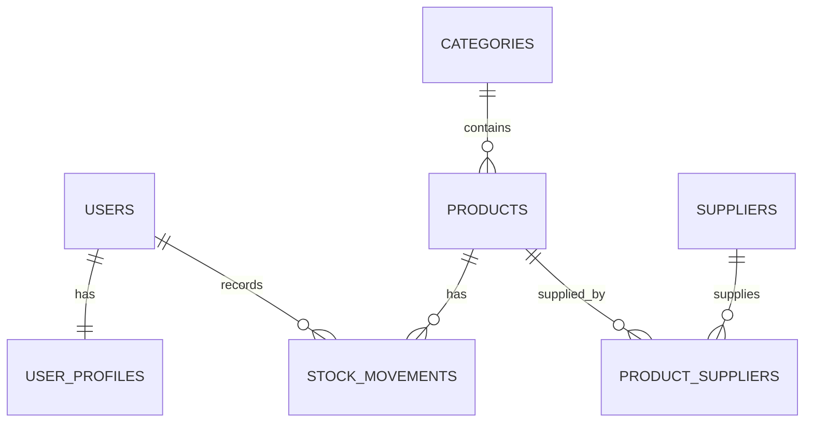

# ERD — Inventory Management System

- `users` ke `user_profiles`: one-to-one, `user_profiles.user_id` UNIQUE.
- `categories` ke `products`: one-to-many.
- `products` ke `suppliers`: many-to-many lewat `product_suppliers`.
- `products` dan `users` ke `stock_movements`: histori transaksi.
