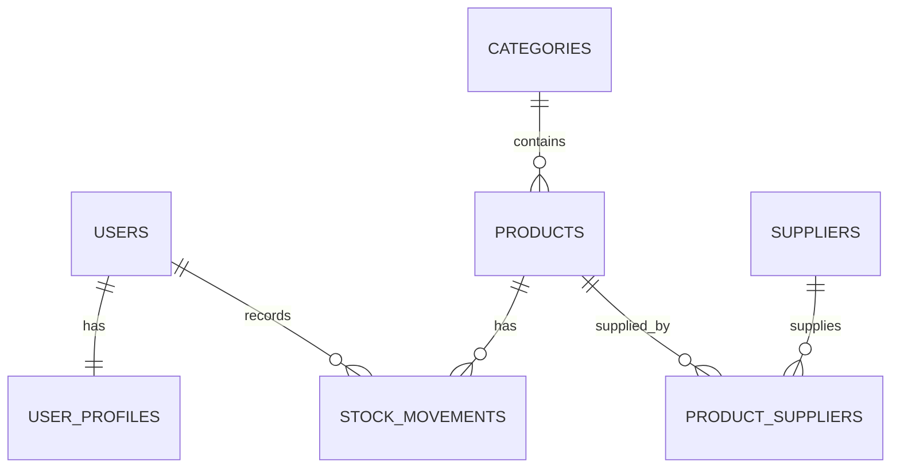

# Web 4 — Mini Project 3: Inventory Management System (PHP Native)

## Fitur sesuai materi Web 4
- Login/logout menggunakan `password_verify`, session regeneration, dan role `admin`/`staff`.
- Relasi database: one-to-one (`users`–`user_profiles`), one-to-many (`categories`–`products`, `products`–`stock_movements`), many-to-many (`products`–`suppliers` melalui `product_suppliers`).
- CRUD kategori, produk, dan supplier (khusus admin); produk dapat dihubungkan ke beberapa supplier.
- Barang masuk/keluar memakai transaksi PDO, `SELECT ... FOR UPDATE`, commit/rollback, dan validasi agar stok tidak negatif.
- Histori transaksi, dashboard, nilai inventory, total barang masuk/keluar, dan peringatan stok rendah.
- Search nama/SKU, filter kategori, sorting melalui allowlist, pagination dengan query string.
- Prepared statements, server-side validation, CSRF token, HTML output escaping, foreign key, unique SKU, dan password hashing.

## Instalasi XAMPP
1. Jalankan Apache dan MySQL.
2. Salin folder `Mini-Project 3` ke `C:\xampp\htdocs\`.
3. Buka phpMyAdmin, impor `database/schema.sql`. File ini membuat database `inventory_db` dan data demo.
4. Jika kredensial MySQL berbeda, ubah `config.php` (default XAMPP biasanya user `root`, password kosong).
5. Buka `http://localhost/Mini-Project%203/` atau `http://localhost/Mini-Project 3/` (browser dapat mengodekan spasi sebagai `%20`).
6. Login menggunakan akun demo di bawah.

## Akun demo
- Admin: `admin` / `password`
- Staff: `staff` / `password`

Password ini hanya untuk demo lokal. Ganti sebelum aplikasi dipakai sungguhan.

## ERD ringkas

ERD juga disertakan pada `docs/ERD.md`.

## Business rules
1. SKU harus unik; kategori produk harus ada.
2. Barang masuk menambah stok dan membuat histori pada satu transaksi database.
3. Barang keluar hanya bisa diproses jika stok cukup; stok dan histori disimpan bersama.
4. Jika salah satu langkah transaksi gagal, seluruh perubahan di-rollback.
5. Stok produk yang sudah mempunyai histori tidak dapat diedit langsung; gunakan menu Transaksi Stok.
6. Produk yang memiliki histori tidak dapat dihapus karena foreign key `RESTRICT`.
7. Hanya admin yang dapat mengelola master data; staff hanya dapat melihat data dan mencatat transaksi stok.
8. Stok rendah ditentukan oleh `stock <= minimum_stock`.

## Checklist pengujian
Lihat `docs/TESTING.md`. Ambil screenshot aplikasi yang benar-benar dijalankan dan simpan di `screenshots/` sebelum dikumpulkan.

## Struktur utama
- `index.php` — UI, routing sederhana, proses form dan validasi.
- `config.php` — koneksi PDO.
- `database/schema.sql` — schema, relasi, constraints, dan data demo.
- `docs/` — ERD, aturan bisnis, dan skenario uji.

## Catatan
Kode PHP sudah diperiksa sintaksnya. Menjalankan aplikasi tetap memerlukan MySQL aktif dan ekstensi PHP PDO MySQL. Screenshot tidak dibuat otomatis karena harus mencerminkan aplikasi yang dijalankan di komputer pengguna.
